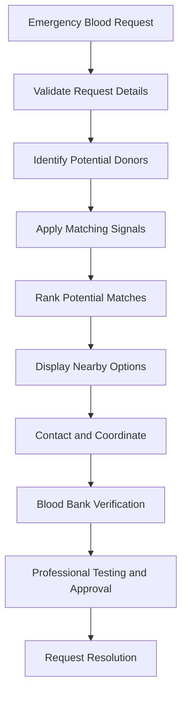

# 🩸 BloodBridge AI
### Connecting the Right Donors to the Right Requests, When Every Minute Matters.

**An AI-assisted emergency blood discovery and coordination platform designed to reduce the time, confusion and effort involved in finding potential blood donors and verified blood-bank support.**

> **Our vision:** Finding blood during an emergency should not depend on searching through multiple contacts, forwarding messages across groups or repeatedly calling different places.

---

## 1. The Real-World Problem

Blood is essential in emergencies, surgeries, childbirth complications and many other medical situations. But getting access to the required blood can involve several disconnected steps.

BloodBridge AI is built around real-world challenges in blood access and emergency coordination.

### Problem 1: Difficulty confirming blood availability

**What happens in real life?**

A family may contact multiple blood banks or people to find a required blood group. Stock information can become outdated, and an online listing does not necessarily mean a unit is still available.

**Our solution — Smart Availability Visibility**

- Display blood-bank and donor information in one coordinated interface.
- Show the last-updated time for availability information.
- Flag outdated or unconfirmed entries.
- Encourage direct confirmation with the relevant blood bank before anyone travels.

**Expected impact:** Less time wasted following outdated information and fewer unnecessary calls.

### Problem 2: Distance creates delays

**What happens in real life?**

A blood bank or potential donor may be far from the patient. Travel time, unfamiliar locations and limited nearby options can make an already stressful situation harder.

Research examining eight Indian states found that only 61.45% of the studied population lived within one hour of a blood bank.

**Our solution — Location-Aware Discovery**

- Identify nearby blood banks and potential donors.
- Rank potential options using distance and availability information.
- Display location details to help users plan their next step.
- Prioritise nearby options without hiding other possible sources.

**Expected impact:** Faster discovery of nearby support and better-informed coordination.

### Problem 3: Emergency coordination is fragmented

**What happens in real life?**

Families may have to contact hospitals, blood banks, relatives and individual donors separately. Information gets repeated, updates are missed, and nobody may have a clear view of the request's progress.

Research from Bihar has documented delays of one to six hours in obtaining blood in some healthcare settings, with distance, stock and coordination among the contributing factors.

**Our solution — Centralised Emergency Request Tracking**

- Create a unique reference for every blood request.
- Keep request details in one place.
- Track statuses such as submitted, matching, contacted and resolved.
- Give authorised responders a shared coordination workflow.

**Expected impact:** Better communication, clearer responsibilities and less confusion during emergencies.

### Problem 4: Finding potential donors takes time

**What happens in real life?**

People may depend on personal contacts, social-media posts and messaging groups to find potential donors. Searching manually can be time-consuming, especially when the required blood group and location are specific.

**Our solution — AI-Assisted Donor Matching**

- Filter potential donors by blood group.
- Consider location and availability.
- Rank potential matches to help responders prioritise outreach.
- Include profile verification status as a trust signal.
- Allow donors to register and update their availability.

**Expected impact:** A more organised way to discover and contact potential donors.

### Problem 5: Emergency speed must not compromise blood safety

**What happens in real life?**

A donor match or an online blood listing does not prove that a donation is medically suitable or that a blood unit is safe for transfusion.

Blood safety requires appropriate screening, testing and professional oversight.

**Our solution — Safety-First Coordination**

- Clearly distinguish a potential donor match from a medically approved donor.
- Require blood-bank or qualified medical-professional confirmation.
- Never use AI rankings as a substitute for clinical compatibility testing.
- Direct users to authorised blood banks for screening, testing and transfusion decisions.

**Expected impact:** Responsible use of AI while keeping medical decisions with qualified professionals.

---

## 2. Our Solution: BloodBridge AI

BloodBridge AI brings emergency blood-request coordination and AI-assisted donor discovery into one web platform.

Instead of making families search through disconnected channels, the platform aims to provide a structured process:

1. Submit an emergency blood request.
2. Discover potential donors and nearby blood-bank options.
3. Rank potential donors using relevant information.
4. Track the request and coordination status.
5. Confirm availability and medical suitability through authorised professionals.

**Our core idea:** AI should reduce the time spent searching and coordinating, while humans and qualified medical professionals remain responsible for critical decisions.

---

## 3. Key Features

| Feature | What it does |
|---|---|
| Emergency Blood Request | Collects blood group, quantity, location and urgency information. |
| AI-Assisted Matching | Ranks potential donors using blood group, location, availability and verification signals. |
| Location-Based Discovery | Helps identify nearby potential donors and blood banks. |
| Donor Registration | Allows volunteers to register and manage their availability. |
| Request Tracking | Provides a central view of request progress. |
| Availability Freshness | Makes it easier to distinguish recent information from stale or unconfirmed entries. |
| Coordination Dashboard | Helps users and authorised responders understand active requests. |

---

## 4. How Our AI Matching Works

The prototype demonstrates a simulated ranking approach using four signals:

| Matching signal | Weight |
|---|---:|
| Blood-group match | 40% |
| Location proximity | 25% |
| Donor availability | 20% |
| Profile verification | 15% |

The system uses these signals to prioritise potential donor profiles for outreach.

**Important:** This is a discovery and prioritisation score, not a clinical compatibility score. The current prototype uses simplified matching logic. Actual donor eligibility, blood-group compatibility, crossmatching and blood safety must be assessed by qualified professionals.

### Proposed matching workflow

---

## 5. What Makes BloodBridge AI Different?

We are not trying to create another blood-donation directory.

Our focus is the **emergency coordination gap** between identifying a need and connecting that need to a verified source of support.

Our differentiators:

- **Emergency-first design:** Built around the blood request journey, not just donor registration.
- **AI-assisted prioritisation:** Helps organise potential donor discovery.
- **Location awareness:** Considers proximity when presenting potential options.
- **Transparent availability:** Makes freshness and confirmation status visible.
- **Trackable requests:** Keeps the coordination process organised.
- **Safety-first architecture:** Leaves medical eligibility and transfusion decisions to authorised professionals.
- **Integration-ready vision:** Designed to complement official blood-bank infrastructure rather than replace it.

---

## 6. Prototype Status

The current hackathon prototype demonstrates the core user experience.

### Implemented in the prototype

- Responsive web dashboard.
- Emergency blood request form.
- Donor registration interface.
- Simulated donor matching and ranking.
- Request tracking interface.
- Demo analytics and donor/request records.

### Planned for the full system

- Secure backend and database.
- Verified blood-bank and hospital onboarding.
- Real-time inventory integration where authorised APIs and partnerships are available.
- Live location services and map-based discovery.
- Secure notifications and donor response workflows.
- Improved AI ranking using validated operational data.
- Privacy, access control and audit logging.

**Transparency:** The current prototype is a frontend demonstration with simulated donor profiles and browser-session data. It does not currently connect to real donors, hospitals or blood-bank inventory, and it does not send real notifications.

---

## 7. Proposed Technology Stack

| Layer | Technology |
|---|---|
| Frontend prototype | HTML5, CSS3, JavaScript |
| Future frontend | React |
| Backend | Python, FastAPI |
| Database | PostgreSQL |
| Location search | PostGIS and Maps API |
| AI ranking | Python, Scikit-learn |
| Notifications | Firebase Cloud Messaging |
| Deployment | Cloud hosting |

The technologies listed under future development are proposed choices, not features already deployed in the current prototype.

---
